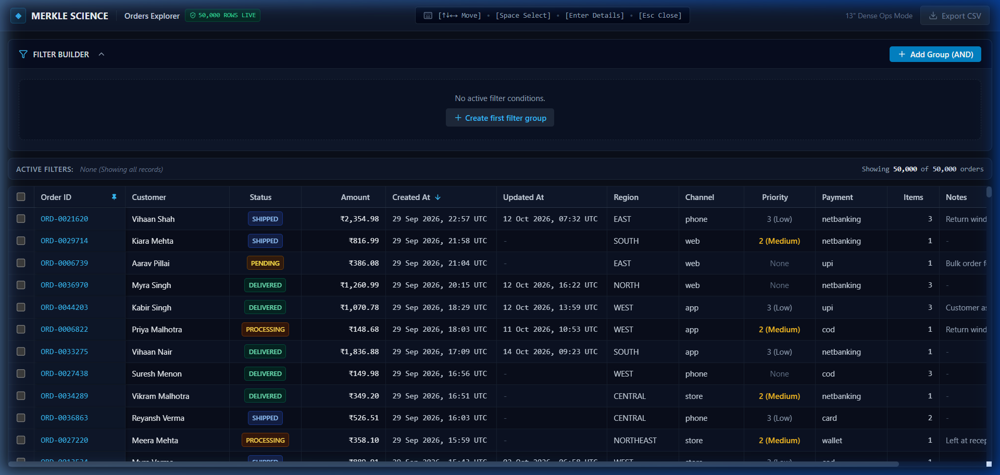
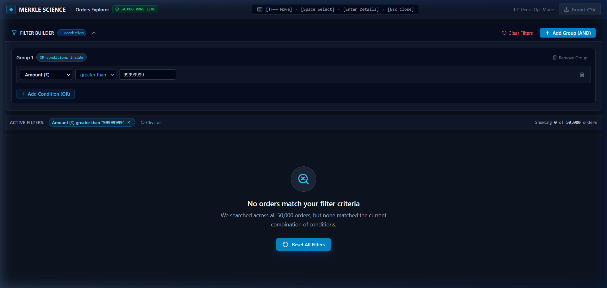

# Orders Explorer

Take-home frontend assignment for Merkle Science. A dense, keyboard-friendly data grid and filter builder built for an ops team working on 13-inch laptops.

Built with **React**, **TypeScript**, **Vite**, and **Tailwind CSS**. All grid virtualization, column resizing, pinning, multi-select, and filter-building logic were written completely from scratch with zero table or query-builder libraries.

---

## 1. How to run it

### Setup
Tested on Node 24 (`v24.15.0`) with npm.

```bash
# 1. Install dependencies
npm install

# 2. Run the dev server
npm run dev
```

Open [http://localhost:5173](http://localhost:5173) in your browser.

```bash
# 3. Production build & type check
npm run build
```

---

## 2. Screenshots

### Normal screen with data (50,000 orders)


### Empty state (0 orders matched)


*(You can also find my initial planning sketches and Excalidraw files in the [`design/`](design/) folder).*

---

## 3. Dependencies

I kept runtime dependencies down to the absolute bare minimum:

- `react` & `react-dom` (`^19.0.0`): Needed for UI component tree and state management.
- `lucide-react` (`^1.16.0`): Lightweight SVG icons (pin, sort arrows, copy button, trash) so I didn't have to manually write inline SVG paths for every button.

*(Tailwind CSS and TypeScript are dev/compile-time tools only and add zero runtime weight. I did not use any table, virtualization, or query-builder libraries).*

---

## 4. Data loading

### How I loaded it
- I placed `orders.json` in `public/orders.json` and fetched it via `fetch('/orders.json')`.
- I moved the fetching, JSON parsing, deduplication, and schema cleanup into a dedicated Web Worker (`src/workers/dataWorker.ts`), with a direct main-thread fallback in case workers are blocked.
- All 10 data cleanup rules from `data-notes.md` are handled in a single normalization pipeline (`src/data/normalize.ts`) before any data reaches the grid or filter:
  - Unified `customer_name` (v1) and `customerName` (v2) into a single Customer field.
  - Converted v1 amounts from paise to rupees (`amount / 100`), parsed string amounts, and formatted them using Indian currency format (`₹1,23,456.50`).
  - Handled all 4 date formats (ISO with tz, ISO without tz treated as UTC, epoch seconds, and DD/MM/YYYY) into real UTC timestamps for correct sorting and filtering.
  - Deduplicated the ~30 duplicate order IDs based on `updatedAt` comparison and file order.
  - Put `updatedAt` nulls last when sorting by that column.
  - Standardized status to lowercase and region to uppercase.
  - Handled missing priority as `None`.
  - Sanitized staff notes to plain text (stripped HTML tags so `<script>` or `<b>` won't render).
  - Trimmed trailing space in `"INR "`.

### Why I chose this
`orders.json` is ~17.2 MB with 50,030 records. Parsing that much JSON and looping through to clean up records takes around 150-200ms of CPU time. Doing all that on the main thread made the page hang for a brief moment right after opening. Moving it into a Web Worker keeps the main UI thread completely free, so the loading spinner stays smooth and the browser never freezes.

---

## 5. The 200 rows question

> *Case: A user selects 200 rows, applies a filter that hides 180 of them, and clicks Export. What do they get?*

### What I chose
**Export only the 20 visible rows that match the active filter**, and update the counter to show `20 selected (filtered from 200)` so the screen count always matches the exported CSV.

### Why
When an ops analyst applies a filter, their focus is on the records currently on their screen. If they export and get 180 hidden records that don't match their current filter, it can easily lead to mistakes (like acting on orders from the wrong status or region). Exporting what is currently visible makes the tool predictable.

To make sure the user doesn't lose track of the other 180 rows they selected, the selection badge explicitly displays both: `20 selected (filtered from 200)`. If they want all 200 back, they can just clear the filter and click Export.

---

## 6. Design changes (vs my initial sketch)

- **Slide-over drawer instead of side split-pane:** In my initial sketch, I drew the order details as a side dock next to the grid. But on a 13-inch screen (around 1280px wide), having 12 data columns plus a persistent 380px side panel made the table feel too squeezed and caused excessive horizontal scrolling. I changed it to a slide-over drawer that pops up on `Enter` (or double-click) and dismisses with `Esc`.
- **Collapsible filter builder:** I added a collapse toggle to the filter builder. Once an analyst sets up their filter conditions, they can collapse the builder to a slim bar with chips, giving the table maximum vertical space.

---

## 7. Known issues & tradeoffs

- **URL length limit on massive selections:** If someone selects all 50,000 rows (e.g. via select-all), putting all 50,000 order IDs into the URL `?sel=...` would blow past the browser URL length limit (which is usually 8KB to 32KB). In that edge case, the app keeps all 50,000 selected in memory, but caps the serialized IDs in the URL to avoid breaking the page.
- **Date timezone boundaries:** Dates are parsed and displayed in UTC as specified in the notes. Filter inputs use UTC day boundaries (`00:00` to `23:59:59 UTC`), so someone in a different local timezone might see orders aligned to UTC days rather than their local midnight.
- **Designed strictly for 13" laptops:** The layout is intentionally dense and keyboard-oriented for quick desktop scanning. It is not designed for mobile screens.

---

## Keyboard shortcuts

- `↑` `↓` `←` `→`: Move focused cell (automatically scrolls the grid into view)
- `Space`: Select / deselect the focused row
- `Enter`: Open details drawer for the focused row
- `Esc`: Close the details drawer
- `Shift + Click`: Select a range of rows
- Click header: Sort column (Ascending → Descending → Reset)
- Header divider drag: Resize column width
- 📌 icon on header: Pin column to the left during horizontal scroll
